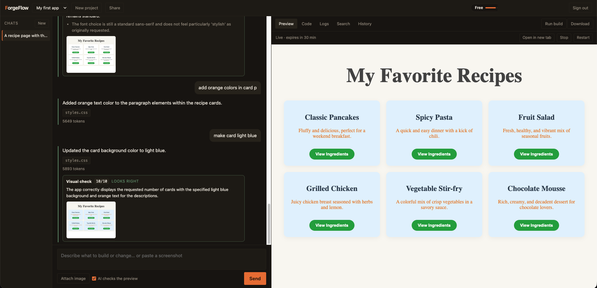
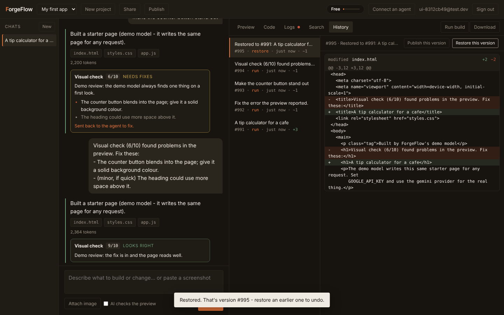
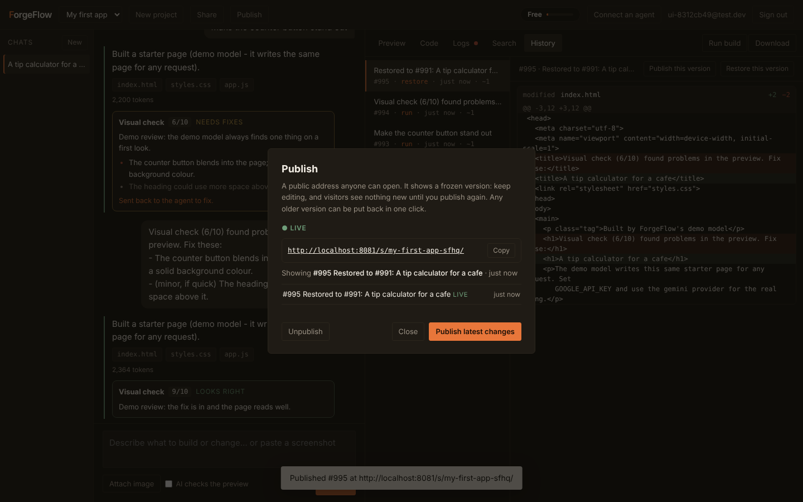
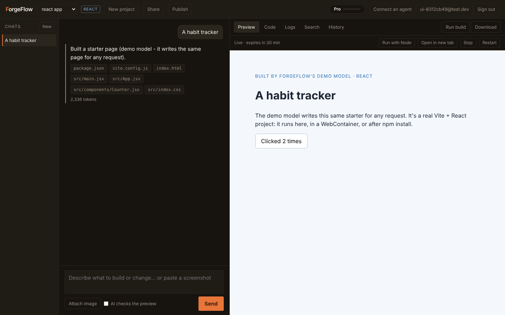
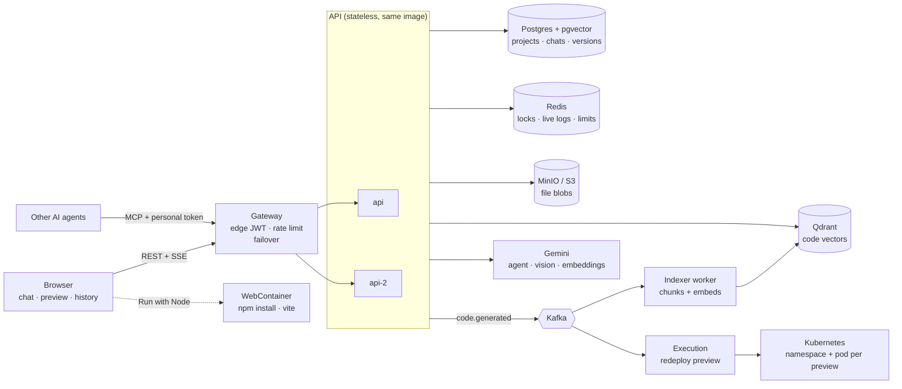

# ForgeFlow

**Describe an app in plain English and get a working, running app back** — then
keep refining it by conversation. An AI app builder in the spirit of Lovable,
built from scratch in Java.

The part that makes it more than a wrapper around a model: **the agent isn't
allowed to finish until the code it wrote passes a build.** When the build
fails, the errors go back to the agent, it fixes them, and tries again.



```
"build me a recipe site with search"
      │
      ▼
agent plans → writes files → calls finish → build check → preview → visual check
      │                                        │                          │
      │                              fails? ◄──┘                 issues? ◄┘
      │                     errors go back to the agent;  a vision model scores a
      │                     it fixes them, finish again   screenshot; one fix round
      ▼
live preview · file tree · version history · every step streamed to the browser
```

**Live:** https://forgeflow-7m08.onrender.com · **API reference:** `/docs.html`

## Measured

| | |
|---|---|
| **App evals** (20 prompts, real Gemini) | **20 / 20** build and pass the gate, in three runs out of three · ~**11 s**, ~**7.5k tokens** and **$0.003** per app · 0 repair rounds needed |
| **Follow-up changes** ("make the button green") | **5 / 5** still build, and all 5 were targeted **edits**, not rewrites of the file |
| **Code search** (42 questions with known answers) | hybrid search finds the right file in the top 3 **97.6%** of the time (MRR 0.90) |
| **Search on paraphrased questions** | top-1 hit rate **57%** hybrid vs **29%** keyword-only - why the vector half is worth having |
| **Tests** | 218 tests against a real Postgres, Redis, Qdrant and S3 API on every push |

How each number is produced: `evals/` and [`docs/WORKLOG.md`](docs/WORKLOG.md).

<table>
<tr>
<td width="33%"></td>
<td width="33%"></td>
<td width="33%"></td>
</tr>
<tr>
<td align="center">a version per AI run, diffs, restore</td>
<td align="center">publish a frozen version, roll back</td>
<td align="center">React + Vite, compiled in the browser</td>
</tr>
</table>

---

## What it does

| Area | Features |
|---|---|
| **Projects** | create, list, rename, delete; share with **editors** and **viewers**; public projects |
| **Auth** | sign up, log in (JWT), get / edit my profile |
| **AI generation** | **screenshot to app** (paste a screenshot or sketch; Gemini builds from it); chat sessions with **memory** (last 10 messages); streaming replies; **retry if failed**; a self-healing build gate; targeted `edit_file` changes; errors from the running preview fed back to the agent |
| **Files** | file tree, file content, save by hand, **download as zip**, who created / last changed each file |
| **History** | a **version per AI run**, coloured diffs between versions, **one-click restore** (itself undoable) |
| **Publish** | a public address serving a **frozen version** (a checkpoint): editing doesn't change it, publishing again does, and any earlier release can be **rolled back** in one click |
| **Preview** | live preview link, start / stop, **a Kubernetes namespace + pod per preview** (redeployed on `code.generated`), **logs stream** — builds, requests, 404s and the generated app's own `console` output |
| **React apps** | create a project as **React + Vite**: the agent writes a real Vite project; the preview **compiles it in the browser** (Sucrase + a tiny module loader); **Run with Node** boots it under real Node.js in a **WebContainer** (`npm install`, `npm run dev`) |
| **AI checks its own app** | after each change the preview photographs itself in the browser, a **vision model** scores it against the request, and major issues go back to the agent for **one automatic fix round** |
| **Search (RAG)** | hybrid code search (pgvector or Qdrant + full-text, weighted rank fusion, optional LLM rerank); the agent has a `search_code` tool; big projects get relevant code attached to each request; **measured** by a 70-question retrieval benchmark |
| **Plans** | FREE / PRO — projects, live previews, AI tokens per day; **Stripe** Checkout and a signed webhook |
| **Platform** | a **stateless API** that scales out (chat locks, live logs and rate limits in **Redis**; the gateway load-balances with failover), Redis **rate limiting**, request **tracing** (W3C traceparent, optional Zipkin), an **MCP server** so other AI agents can drive it - as *you*, with **personal access tokens** (hashed, shown once, revocable) |
| **Architecture** | runs as one app (Render) **or** the full diagram: API gateway, Kafka + indexing worker, MinIO/S3, Qdrant, Kubernetes manifests |

## Architecture in one picture



Inside the API it is one deployable split into modules along the lines a
service split would follow - `account`, `workspace`, `chat`, `intelligence`,
`execution`, `billing`, `mcp`. Modules talk only through each other's service
classes; a test fails the build if one reaches into another's tables.

Details, decisions and trade-offs: [`docs/architecture.md`](docs/architecture.md).

### Two deployments, one codebase

The spec's diagram draws a gateway, Kafka, MinIO, Qdrant and Kubernetes. All
of them are built - each behind a seam, switched on by configuration:

```
all-in-one (Render, free tier)          full topology (docker-compose.full.yml, deploy/k8s)

  browser ─► app ─► postgres              browser ─► gateway ─► api ─┬─► postgres   rows, chunks
                                                       edge JWT,    ├─► minio      file contents
  events:  in-process                                  SSE proxy    ├─► qdrant     vector search
  files:   postgres                                                 ├─► redis      rate limits
  vectors: pgvector                                                 └─► kafka ─ code.generated ─┬─► worker (indexer)
                                                                                                └─► api (preview notices)
```

```bash
docker compose -f docker-compose.full.yml up --build     # then http://localhost:8080
```

## Stack

Java 21 · Spring Boot 4.1 · PostgreSQL 16 + pgvector · Flyway · Gemini
(`gemini-3.1-flash-lite`, embeddings `gemini-embedding-001`) · Redis (optional) ·
plain HTML/CSS/JS front end · JUnit 5 against a real database · GitHub Actions.

Deliberately **no** Spring AI, no Stripe SDK, no Redis client library, no
tracing library: each of those integrations is a small, readable class over
plain HTTP or a socket — see the chapters in `docs/UNDERSTANDING.md`.

## Run it locally

```bash
docker compose up -d                 # Postgres (+ pgvector) on 5433, Redis on 6379
cp .env.example .env                 # then fill in GOOGLE_API_KEY and JWT_SECRET
set -a; source .env; set +a
./mvnw spring-boot:run               # http://localhost:8081
```

**No API key? Use demo mode.** The demo model writes the same small starter page
for any request, but through the real pipeline — tools, build gate, memory,
logs, quotas — so everything in the UI works:

```bash
FORGEFLOW_LLM_PROVIDER=demo FORGEFLOW_BILLING_PROVIDER=fake \
FORGEFLOW_EMBEDDER=hashing FORGEFLOW_SANDBOX_PROVIDER=in-process \
./mvnw spring-boot:run
```

### Configuration

| Variable | Default | What it does |
|---|---|---|
| `GOOGLE_API_KEY` | — | Gemini, for generation and embeddings |
| `FORGEFLOW_LLM_PROVIDER` | `gemini` | `demo` = offline stand-in model |
| `FORGEFLOW_SANDBOX_PROVIDER` | `docker` | `in-process` where there's no Docker daemon (Render, CI) |
| `FORGEFLOW_EMBEDDER` | `gemini` | `hashing` = offline, keyword-level embeddings |
| `DB_URL` / `DB_USERNAME` / `DB_PASSWORD` | local compose | Postgres |
| `JWT_SECRET` | dev-only value | **set this in production** |
| `REDIS_URL` | — | share rate limits across instances (`redis://` or `rediss://`) |
| `FORGEFLOW_BILLING_PROVIDER` | `none` | `fake` (local only) or `stripe` |
| `STRIPE_SECRET_KEY`, `STRIPE_PRO_PRICE_ID`, `STRIPE_WEBHOOK_SECRET`, `APP_BASE_URL` | — | Stripe — setup in `docs/notes.md` §14 |
| `ZIPKIN_URL` | — | export traces, e.g. `http://localhost:9411` |
| `FORGEFLOW_MCP_SERVICE_EMAIL` | `mcp-service@forgeflow.internal` | the account MCP calls act as |
| `FORGEFLOW_MCP_API_KEY` | — | optional shared key for `/mcp` as the service account; people normally use their own token (**Connect an agent**) |
| `FORGEFLOW_MCP_OPEN` | `false` | `true` lets `/mcp` run with no credentials - local use only |

## Tests

```bash
./mvnw verify          # needs Postgres; Redis tests run if Redis is up, skip if not
```

Every test runs against a real Postgres — no mocked repositories. Qdrant and
S3 tests run when `QDRANT_TEST_URL` / `S3_TEST_ENDPOINT` point at a server
(CI starts both), Kafka tests when a broker is up. The model is
replaced by a **scripted** one that plays back tool calls, which is how the
self-healing loop is tested on every push. Each feature's test was checked by
breaking the feature on purpose and watching it go red.

Also under test: the API reference matches the routes Spring serves, module
boundaries hold, and an SSE stream ends cleanly on a real Tomcat.

Two evals against real Gemini:

```bash
python3 evals/run_evals.py --base <url>            # 20 prompts: does the app build? (+5 follow-up edits)
python3 evals/run_retrieval_eval.py --base <url>   # 70 questions (v2, with decoy files): does search find the right file?
                                                   # --set v1 = the original 42; --rerank adds the LLM rerank
```

Browser walk-through (sign up → chat → preview → logs → visual check and
auto-fix → search → history → upgrade → share → screenshot → quota), against
a demo-mode server:

```bash
python3 scripts/ui-walk.py
```

## Docs

| | |
|---|---|
| [`docs/UNDERSTANDING.md`](docs/UNDERSTANDING.md) | how it works, from scratch, chapter by chapter, each ending in interview-style questions |
| [`docs/architecture.md`](docs/architecture.md) | the design, the spec mapped onto the code, every deliberate deviation |
| [`docs/WORKLOG.md`](docs/WORKLOG.md) | what was built when, including the mistakes |
| [`docs/notes.md`](docs/notes.md) | practical notes and gotchas — setup, Stripe, Redis, tracing |
| [`docs/INTERVIEW.md`](docs/INTERVIEW.md) | the 2-minute pitch, the walk-through, likely questions, and the bugs worth telling |

## Not built yet

- **A run on a real cluster.** Kubernetes previews (a namespace + pod per
  preview) are built and tested against a fake API server.
- **A server-side browser** for the visual check and runtime errors, so they
  happen without anyone opening the preview.

Everything in the spec's diagram - gateway, Kafka, MinIO, Qdrant,
WebContainer, a Kubernetes pod per preview - is built; see
`docs/architecture.md` §17.6 and §18-24.

---

Built by [Aman Raj Verma](https://github.com/ARV0007).
